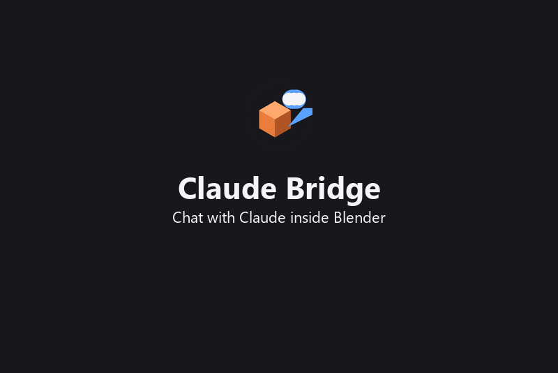

# Claude Bridge for Blender

[](https://github.com/JackLuciano/claude-bridge-blender/releases/latest)
[](LICENSE)


**[⬇ Download the latest release](https://github.com/JackLuciano/claude-bridge-blender/releases/latest)**: install the
zip via *Edit ▸ Preferences ▸ Get Extensions ▸ Install from Disk*.



<!-- mcp-name: io.github.JackLuciano/claude-bridge-blender -->

Drive a live Blender with Claude, **from a chat panel inside Blender** or **from Claude Code**, using
compact, high-level ops instead of throwaway Python scripts. Runs on your normal Claude subscription
(Pro/Max) through the Claude Code CLI. No API key is needed.

```
 Blender sidebar chat ──spawns──▶ claude CLI (headless, your login) ─┐
                                                                     ├─ MCP stdio ─▶ mcp_server.py ─TCP 127.0.0.1:9877─▶ addon ─▶ bpy
 Claude Code (terminal / desktop) ───────────────────────────────────┘
```

## Features

- **In-Blender chat** (View3D ▸ Sidebar ▸ **Claude**): replies stream in live, tool calls are shown inline, and
  Claude changes the scene while you watch.
- **Chat history**: every chat is saved. Pick an old one from the dropdown to reopen it; the Claude
  session resumes with its full context.
- **Screenshots and images**: attach a clean viewport capture, the whole Blender window, an image file, or
  **paste with Ctrl+V** (works even while typing in the chat field; Windows).
- **Model picker**: Opus (default), Sonnet, Haiku, or your CLI default.
- **Built-in skill** ([`claude_bridge/skill/SKILL.md`](claude_bridge/skill/SKILL.md)): workflow and real-world
  modelling tips (sizes, grounding objects, lights, camera framing). It is added automatically to every in-Blender
  chat, and installed for Claude Code as the `blender-bridge` skill (by `install.py`, or **Bridge ▸ Install Claude
  Code skill**).
- **Token-lean by design**:
  - The chat process runs with no built-in tools, skills, other MCP servers or user hooks. That is about
    **6.7k context tokens** per message versus about 62k for a default `claude -p`.
  - Two MCP tools with a schema under 3.5 KB.
  - Each op is about 20 tokens, its reply is one line, and a batch is one call and one undo step.
  - Captures are small JPEGs of the viewport only, with no UI.

## Why ops instead of scripts

| | Script-based bridge | Claude Bridge |
|---|---|---|
| Typical action | 200–600 tokens of Python | `{"op":"move","obj":"Box","by":[0,0,1]}` |
| Result | free-form prints / tracebacks | `Box[mesh] @(0,0,1) dim(2,2,2) mat:Wood` |
| Verification | separate query call | built into every op's reply |
| Many changes | many calls | one batch = one call = **one undo step** |
| Seeing the scene | full screenshots | `look`: 256–512 px JPEG of the viewport only |

Python is still there as a last resort (`py` op).

## Install

Requirements: Blender 4.2+ (tested on 5.2), Python 3.10+ for the installer, and
[Claude Code](https://claude.com/claude-code) installed and logged in (`claude` once in a terminal).

### From a release (easiest)

1. Download `claude_bridge-x.y.z.zip` from [Releases](https://github.com/JackLuciano/claude-bridge-blender/releases).
2. In Blender, go to **Edit ▸ Preferences ▸ Get Extensions ▸ ⌄ ▸ Install from Disk…** and pick the zip.
3. The in-Blender chat works right away.
4. **For Claude Code** (optional): in **Sidebar ▸ Claude ▸ Bridge**, click **Copy Claude Code setup command** and run
   it once in a terminal, then click **Install Claude Code skill**. Restart Claude Code.

### From source

```bash
git clone https://github.com/JackLuciano/claude-bridge-blender
cd claude-bridge-blender
python install.py
```

`install.py` links `claude_bridge/` into Blender's user add-ons (use `--copy` to copy instead), enables it,
registers the MCP server with Claude Code as `blender-bridge`, and installs the `blender-bridge` skill
(skip the Claude Code steps with `--no-mcp`).

Start Blender and open the **Claude** tab in the 3D view sidebar (press `N`). The bridge starts automatically.

- **In Blender:** type in the chat field and press Enter.
- **In Claude Code:** just ask, e.g. *"make a low-poly table with a wooden material, then show me"*.

## Chat panel

| Control | What it does |
|---|---|
| Chat dropdown / ➕ / 🗑 | switch between saved chats, start a new one, delete the current one |
| Text field + ▶ | send (Enter also sends); ✖ stops a running reply |
| 🧊 Viewport | attach a clean capture of the 3D viewport |
| 🪟 Window | attach a screenshot of the whole Blender window (UI included) |
| 🖼 File / 📋 Paste | attach an image file / the clipboard image (or just press **Ctrl+V**) |
| Model | Opus (default) · Sonnet · Haiku · CLI default |

Chats are stored as JSON under Blender's config folder (`…/config/claude_bridge/chats/`).

## MCP tools

### `bl`: run a batch of ops

```json
{"ops": [
  {"op": "new"},
  {"op": "add", "type": "cube", "name": "Top", "dims": [2, 1, 0.08], "loc": [0, 0, 0.75],
   "mat": {"name": "Oak", "color": "#a0703c", "rough": 0.6}},
  {"op": "add", "type": "cylinder", "name": "Leg", "dims": [0.06, 0.06, 0.72], "loc": [0.9, 0.4, 0.36], "mat": "Oak"},
  {"op": "dup", "obj": "Leg", "n": 1, "by": [-1.8, 0, 0]},
  {"op": "mod", "obj": "Top", "type": "bevel", "props": {"width": 0.01, "segments": 3}},
  {"op": "view", "frame": "all", "shading": "material"}
]}
```

Ops run in order, stop at the first error (reported with its index), and the whole batch is one undo step.
`obj` is a name, a list of names, `"sel"` or `"active"`. Angles are degrees. Colors are `"#rrggbb"` or linear `[r,g,b]`.

| Op | Args |
|---|---|
| `scene` | `filter`, `type`: compact object list |
| `info` | `obj`: transform, mesh stats, modifiers, light/camera data |
| `get` / `prop` | `path` (`scene.render.fps`, `Cube.data.energy`, `objects.Cube.location`), `value` |
| `add` | `type` (cube, sphere, ico, cylinder, cone, plane, circle, torus, monkey, grid, empty, text, curve, camera, point, sun, spot, area), `name`, `loc`, `rot`, `scale`, `dims`, `size`, `mat` (name, color or dict), `color`, `smooth`, `body`, `energy`, `args` |
| `set` / `move` | absolute / relative transforms, `hide`, `parent`, `smooth`, `props{dotted.attr: val}` |
| `del`, `dup`, `select`, `join` | delete / duplicate (`n`, `by`, `linked`) / select / join |
| `mat` | `obj`, `name`, `color`, `metal`, `rough`, `alpha`, `transmission`, `ior`, `emit`, `emit_strength`, `coat`, `spec`, `slot` |
| `tex` | procedural texture on an object's or named material: `kind` (wood, fabric, marble, noise, brick, checker, tiles, leather, concrete), `color1`, `color2`, `scale`, `bump`, `rough [min,max]` |
| `mod` / `apply` | add or edit modifiers (bevel, subsurf, array, mirror, solidify, bool, …), apply modifiers or transforms |
| `aim`, `cam` | point at an object or point; create/update the scene camera |
| `view` | `preset`, `orbit [yaw,pitch]`, `zoom`, `dist`, `at`, `frame`, `shading`: drives the user's viewport |
| `bop` | any `bpy.ops` operator: `id`, `args`, `obj`, `edit`, `ctx: "view3d"` |
| `render`, `import`, `export`, `save`, `open`, `new`, `undo`, `redo` | files and history |
| `py` | last-resort Python; assign `out` to return a value |

### `look`: see the result

Returns a small JPEG (default 512 px) rendered from the viewport with OpenGL, so it has no UI, popups or other
windows. `cam: true` gives the scene camera's view. View args (`preset`, `orbit`, `zoom`, `frame`,
`shading`) are applied first, so "orbit 45° and show me" is a single call.

## Tests

```bash
python run_tests.py                                    # headless: ops, chat, MCP end-to-end (30 tests)
python tests/live_smoke.py --chat                      # running Blender GUI: viewport, look, real chat, paste
blender --python tests/live_paste.py                   # Windows: real Ctrl+V keystroke into the chat
```

`--chat` makes a few real Claude requests on your subscription.

## Security

The addon listens on **127.0.0.1 only** and executes whatever ops it receives, including `py`. Any local process
can connect while Blender is running. Stop the bridge from the **Bridge** subpanel when you don't need it.
The chat's Claude process can use only the two bridge tools: no shell, no file access.

## Notes

- Ctrl+V paste: Windows works everywhere, including the text field. On macOS/Linux it works over the sidebar but
  not while editing the text field; use the 📋 button there. Clipboard reading uses `pngpaste`/AppleScript on
  macOS and `wl-paste`/`xclip` on Linux.
- Port: `CLAUDE_BRIDGE_PORT` for the MCP server; `claude_bridge.PORT` in the addon (default `9877`).

## Contributing

Feel free to fork, modify and improve it. Issues and pull requests are very welcome, from small fixes to new
ops. See [CONTRIBUTING.md](CONTRIBUTING.md) for setup, how to add an op, and the test commands.

## License

GPL-3.0-or-later (required for Blender add-ons that import `bpy`).
